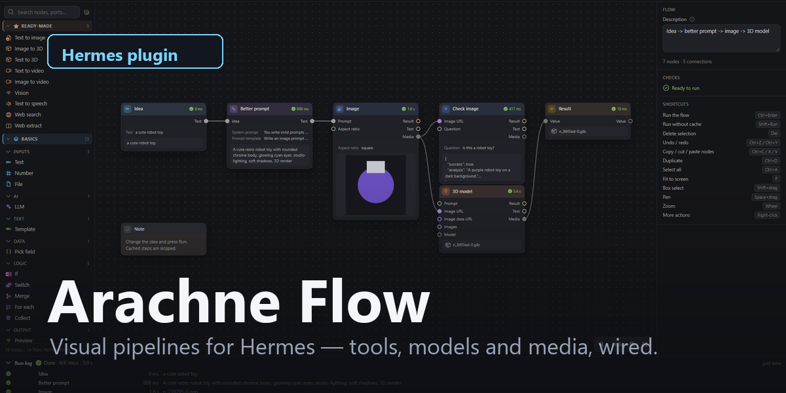
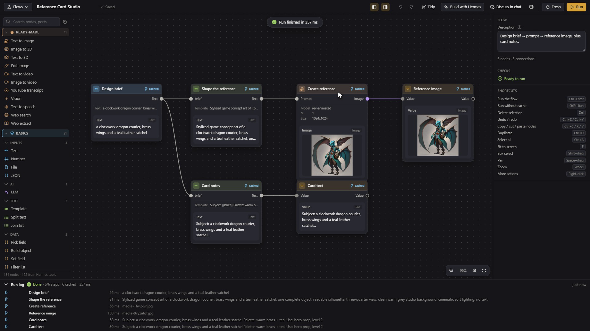
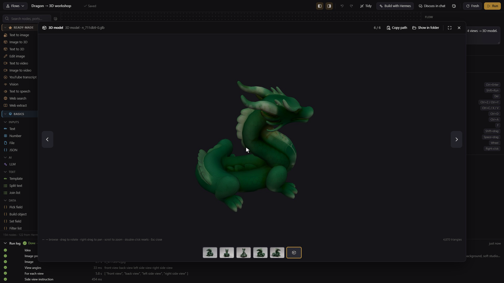
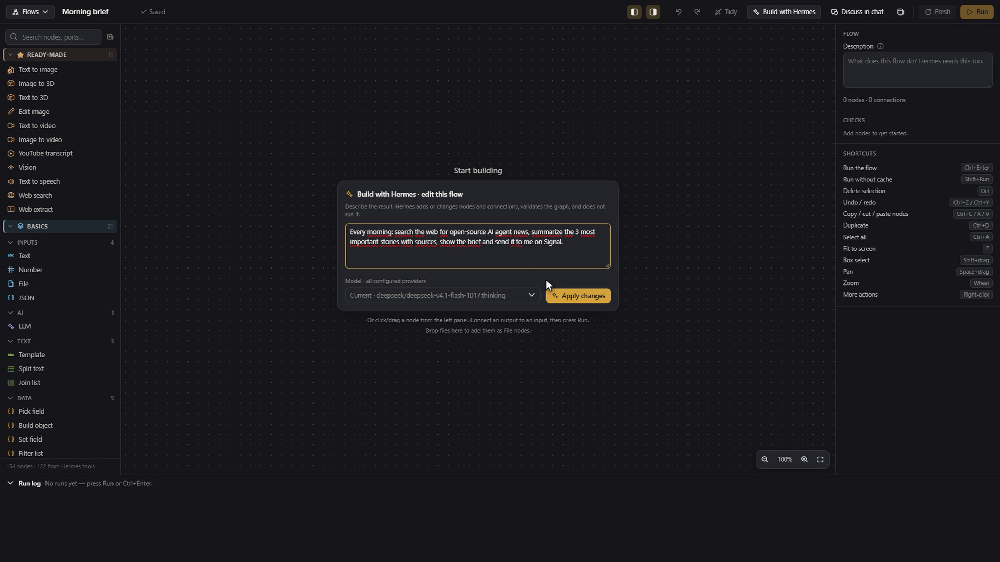

# Arachne Flow



Arachne Flow (`flowcanvas`) adds a visual workspace to Hermes Desktop where you connect tools, AI models, and media files like a wiring diagram — and run the whole pipeline from the canvas, from chat, or on a schedule.

## What you can build

- **Turn one idea into a 3D model** — Type a short prompt, generate a clean front image, create left, back, and right views in parallel, and feed all four angles into an Image-to-3D node to inspect a `.glb` mesh right on the canvas.
- **Write and render a short video** — Ask an LLM node to turn a rough topic into a camera-ready scene description, wire that text into a Text-to-Video node, and play the finished MP4 inside the output card.
- **Research a topic into a cited brief** — Run multiple web searches at once, extract the best pages, and have an LLM combine them into a structured markdown report with links.
- **Automate a daily digest** — Build and test a workflow visually until the output looks right, then trigger its flow ID from a Hermes cron job every morning without opening the editor.

## Install

This is the public source repository. It is **not yet an accepted Hermes plugin-catalog entry**.
Install directly from GitHub with Hermes' plugin manager:

```bash
hermes plugins install EmotionalThrifty/arachne-flow --enable
```

For a reproducible install, append `--ref <full-40-character-commit-sha>` using a commit from this repository.
The plugin ID remains `flowcanvas`; the repository name is `arachne-flow`. Installing by the bare catalog
name `flowcanvas` is not promised until a catalog entry has been accepted.

Restart Hermes Desktop through your normal launcher after installation. **Arachne Flow** appears in the
sidebar, `/flow` is available in chat, and the agent can use the `flow_*` tools.

For image, video, 3D, and YouTube transcript presets, separately enable `@nanogpt/mcp` in Hermes' MCP
settings. Other tool-backed nodes also require their corresponding Hermes tools and provider settings.
Start with the fully local **Local list cleanup** template to avoid provider calls or charges.

### Preview and review status

The Desktop UI uses only `@hermes/plugin-sdk`; `hermes plugins validate` reports no warnings. Offline tests and the
isolated browser harness do not establish that every visible action works on every OS or provider.

The gallery below uses frames from recorded clips of the real plugin UI in an isolated filming setup.
Media examples replay previously generated assets; these screenshots are not receipts for new provider
calls or a full native Desktop acceptance test. The Build dialog edits a graph; it does not execute it.
Older illustrative harness screenshots also remain in `docs/screenshots/` but are not used in this gallery.
The banner is AI-generated artwork, not an official Nous logo or endorsement. No personal workflows,
credentials, recipient authorizations, development history, or demo recordings are included.

## On the canvas

### Image workflows and visible cache hits

Connect prompts, image generation and text outputs; inspect the cached steps directly on the graph.



### Inspect a 3D result

Open a saved GLB result in the built-in viewer to rotate, pan and zoom.



### Build with Hermes

Describe the workflow you want. Build edits the graph; Run executes it.



## Your first flow in two minutes

1. Open **Arachne Flow** from the Hermes Desktop sidebar.
2. Open **Flows** and choose **Local list cleanup** for a fully local first run. Other templates include **Web research digest** (web + LLM tools) and **Prompt → image → 3D** (`@nanogpt/mcp`); these can call external providers. Choose **New blank flow** to start empty.
3. Click any node to edit its settings in the right inspector. Drag from an output port (`●` on the right of a node) to an input port (`●` on the left of another node) to connect them — compatible ports highlight in green.
4. Prefer to describe it in words? Click **Build with Hermes** in the top bar, type what you want (for example: *"Search the web for two topics in parallel and summarize both into a report"*), and click **Build flow**.
   Hermes places the nodes, wires them, and lays out the canvas. **Build with Hermes only edits the diagram — it does not run the flow or media tools. The model call used to build the graph can itself cost provider credits.**
5. Click **▶ Run** (`Ctrl+Enter`). Nodes light up live as they execute; click any finished image, audio player, video, or `.glb` 3D model to open it in the full-window viewer.

Want to iterate with the agent in a normal conversation? Click **Discuss in chat** in the top bar.
It saves the flow and opens a Hermes chat pre-filled with the flow name and ID; changes the agent makes with `flow_apply` appear on your canvas live.

| Action | Shortcut / Control |
|---|---|
| Run flow / Run ignoring cache | `Ctrl+Enter` or **▶ Run** / `Shift` + click **▶ Run** |
| Run from selected node onward | **▶ From here** (toolbar or node inspector) |
| Add a node | Double-click empty canvas, or drag it from the palette |
| Undo / Redo | `Ctrl+Z` / `Ctrl+Y` (`Ctrl+Shift+Z`) |
| Copy / Cut / Paste / Duplicate | `Ctrl+C` / `Ctrl+X` / `Ctrl+V` / `Ctrl+D` |
| Select all / Delete selection | `Ctrl+A` / `Delete` or `Backspace` |
| Fit view / Save | `F` / `Ctrl+S` |
| Box select / Pan / Zoom | `Shift` + drag / `Space` + drag / mouse wheel |
| Add local file node | Drag a file from your computer onto the canvas (≤ 25 MB) |

**Run from chat or cron:**
Use `/flow` to list flows, `/flow run <name|id> [--fresh]` to execute one, `/flow open [name|id]` to open it on the canvas, or `/flow status <run_id>` for the latest state.
In chat or scheduled jobs, Hermes uses `flow_list`, `flow_get`, `flow_node_types`, `flow_apply`, `flow_run`, `flow_status`, and `flow_template_save` (guided by the bundled `flowcanvas:flowcanvas` skill).

## Features — what makes it different

- **Automatic parallel execution** — Independent branches and `For each` loop items run at the same time (up to `max_parallel`, default `3`).
  The runner schedules every ready node automatically as soon as its upstream inputs finish.
- **Live status and per-node timings** — Every node displays `idle`, `running`, `done`, `cached`, `error`, or `skipped` in real time, with a live elapsed clock on active nodes and a `done/total` progress counter in the header.
- **Every output on the card** — A finished node with several outputs shows up to four compact rows (thumbnail, port label, filename or a one-line value, type badge) plus a `+N` row, so images, 3D models, audio, video, text, and JSON stay visible without opening the inspector. Clicking a row opens the same lightbox.
- **Per-node content cache** — Cacheable nodes hash their type, parameters, incoming values, file SHA-256 digests, and tool schema.
  Reusable upstream cache hits avoid another provider call for that step. Cache reads still take time; some steps intentionally never cache. This is not a promise that every repeat run is free or instantaneous.
  Hold `Shift` while clicking **▶ Run** (or pass `--fresh`) to force a fresh run.
- **Visible branching and loops** — `If`, `Switch` (up to 20 cases), `Merge`, and `For each → Collect` put conditions and list processing right on the canvas.
  Untaken branches mark downstream nodes as `skipped` instead of failing the run.
- **Send text or an attachment (explicit opt-in)** — A `Send message` node posts text or one connected media file through Hermes' own messaging bridge to one fixed recipient.
  It appears only when the official `mcp-serve` plugin exposes `channels_list` and `messages_send`; the raw send tool stays blocked in the palette.
  The recipient list comes from the bridge; when it is empty, type a target from `hermes send --list` (`signal:<recipient>`, `telegram:<id>`, …).
  Sending is off by default. Text requires **Enable sending to this recipient**; file uploads require the separate **Enable text and file sending** action. Connect the media output to **Attachment**, not **Message**. A copy or template never inherits consent. Each run sends real, irreversible messages with no cache or automatic retry.
- **Same flow in UI, chat, and cron** — Every flow is a plain JSON file on disk.
  A pipeline you build on the canvas runs identically via `/flow run`, `flow_run` in chat, or an unattended cron schedule.
- **Built-in media and 3D viewer** — Output cards render formatted markdown, JSON, images, audio, video, and interactive WebGL `.glb` 3D models (orbit, zoom, wireframe, lighting, auto-rotate, background).
  Click any media preview to open an 85%-viewport lightbox or reveal the file in your OS file manager.
- **12 starter templates + custom templates** — Ships with two fully local data flows (*Local list cleanup*, *JSON objects through a loop*), five `@nanogpt/mcp` media flows (*Prompt → image → 3D*, *Edit an image*, *Idea to video*, *Animate a picture*, *YouTube summary*) and five Hermes tool + LLM flows (*Web research digest*, *Blog post writer*, *Describe an image*, *Text → speech*, *Translate and speak*).
  Save any flow as a reusable user template via **Save as template** or `flow_template_save`.
- **Second window mode** — Pop Arachne Flow into its own window so you can watch a pipeline execute side by side with your Hermes chat.

## Security and disclosure — safety first

- **Dangerous tools blocked by default** — File-writing, shell, browser-automation, and session-mutating tools (`write_file`, `patch`, `terminal`, `execute_code`, `process_manage`, `computer_use`, `browser_vault`, `browser_cdp`, `browser_dialog`, `browser_exec`, `delegate_task`, `cronjob_manage`, `clarify`, `memory`, `skill_manage`, `discord`, `discord_admin`, `mcp__messaging__messages_send`, `mcp__blender__execute_blender_code`, `mcp__godot_ai__editor_manage`, `mcp__godot_ai__script_create`, `mcp__godot_ai__script_patch`, and internal prefixes `kanban_`, `flow_`, `yb_`, `feishu_`, `send_message`) are hidden from the palette and refused at runtime.
  The raw messaging bridge tool is blocked because the dedicated `Send message` node is the only supported way to reach it.
- **Sending needs a deliberate opt-in** — The `Send message` node stores one recipient; a target edit, a duplicate, a template, or restoration of a revoked authorization disables sending. An unchanged current authorization survives ordinary saves; the executor requires an authorization for that flow, node, and target.
  A fresh randomized authorization is checked against the saved node under a cross-process lock immediately before dispatch; restore clears consent before making a flow active. Timeouts and cancellations report delivery as **unconfirmed** and are never retried automatically. A call already handed to the host cannot be recalled. The node is never cached, and message bodies are not recorded as reusable inputs. Real delivery is not part of offline acceptance; see [messaging safety and test limits](docs/GATEWAY-SEND-BLOCKER.md).
  Attachments are limited to one nonempty supported media/document file inside the current run output directory (maximum 100 MiB); arbitrary local file paths and raw `MEDIA:` in text are refused. Platform limits may be smaller. Text-only consent never authorizes files.
  MCP tools are blocked by name only, so other third-party MCP tools can still write files or call external services when invoked.
  If you explicitly add `write_file` or `patch` to `allow_tools`, flows can overwrite files in the Hermes working directory without a per-write prompt.
- **Background execution and approvals** — Flow tool nodes execute on a background thread via `ctx.dispatch_tool` rather than on the interactive chat turn.
  Under `APPROVAL_MODE=manual`, commands held for interactive approval cannot show a prompt on the canvas and will be denied or time out; inside unattended `cron` runs there is no interactive user at all.
- **Local files and path boundaries** — `File` nodes read only paths you select with **Browse…** or drop onto the canvas (≤ 25 MB per file, copied into `uploads/`).
  A **Browse…** pick is signed for that flow, node and file (`picked_files`, HMAC with the local key); a path set by the agent (`flow_apply`, `flow_run` inputs), a template or by typing is accepted only inside `uploads/`. Any agent edit of a node drops its picks, and a copy or template never carries them; pick the file again after such an edit.
  A text that names a local file is inlined into a tool argument (`*DataUrl`, `*_url`, base64) only for a file you picked or a media file under the folders listed below. Hermes credential stores (`auth.json`, `.anthropic_oauth.json`, `mcp-tokens/`, `vault/`, `browser-profile/` …), any `.env*` file and the plugin's own `messaging-secret` are never read, not even when picked.
  Path traversal (`..`) and Windows UNC or device paths (`\\server\share`, `\\?\`, `\Device\`) are rejected before touching the filesystem.
  Local paths returned inside tool JSON are copied into the run only if they have a media extension inside `<HERMES_HOME>`, `<HERMES_HOME>/plugin-data/flowcanvas/`, or directories listed in `FLOWCANVAS_MEDIA_ROOTS` (`os.pathsep`-separated).
  Prose fields (`content`, `markdown`, `html`, `transcript`, `text`) are never scanned for paths, and `$media` / `$large` keys in untrusted tool or LLM output are defanged (`_$media`, `_$large`).
- **Network and regex protection** — Remote media URLs in tool outputs are validated on every redirect hop (max 5 hops) with Hermes' `is_safe_url` and `create_ssrf_safe_async_client` (blocks private/loopback/link-local IPs, pins the resolved IP, ignores env proxies, 120 s timeout, 200 MB cap).
  User regexes in `If` and `Switch` run in an isolated subprocess killed after 0.5 s.
- **No provider credentials in flows, no telemetry, no update checks** — Provider credentials stay under Hermes control. Flow JSON can contain user text, recipient identifiers and signed send authorizations; do not publish personal flows. The plugin stores a local HMAC key (`messaging-secret`) for consent, not provider credentials.
  The plugin ships no telemetry and never fetches or replaces its own code.
  The Desktop UI uses only `@hermes/plugin-sdk`.
- **What leaves your machine** — The plugin itself talks to the network only where your flow does: media downloads from tool output (previous point) and the LLM/MCP providers your nodes call.
  `File` nodes and canvas drops are copied into the run and handed to the tools you wire to them; sending such a file to an external tool (an image to a model provider, for example) transmits it as part of that call, sometimes as a `data:` URL.
  **Build with Hermes** sends your prompt, the node catalog, and the current flow to the active model provider. It never executes the flow or spends credits on tools.
- **Where your data lives** — All plugin data stays on your machine under `<HERMES_HOME>/plugin-data/flowcanvas/` (or `$FLOWCANVAS_DATA_DIR`):

| Folder | Contents & retention |
|---|---|
| `flows/<id>.json` | Saved flow graphs (`flows/.trash/` keeps deleted flows for 30 days) |
| `runs/<flow_id>/<run_id>.json` | Run status, timings, and outputs (keeps the 30 most recent runs per flow) |
| `outputs/<run_id>/` | Values over 64 KB and generated media files for each run |
| `cache/<flow_id>/` | Per-node result cache (capped at 500 entries/flow, 5,000 total, 2 GiB disk budget) |
| `uploads/<hash>/` | Files dropped onto the canvas (unreferenced uploads are cleaned up after 30 days) |
| `templates/` | User-saved templates (`u-*`, with 30-day `.trash/` recovery) |

## Node types at a glance

| Type | What it is for | Example |
|---|---|---|
| **Text** (`input.text`) | Provide a constant text prompt, URL, or JSON snippet | Enter a research topic or system instruction |
| **Number** (`input.number`) | Provide a numeric constant | Set a threshold or result count |
| **JSON / Build object / Set field** (`input.json`, `json.build`, `json.set`) | Enter and transform bounded typed data without a model | Build structured per-item objects |
| **Split / Join / Filter / Deduplicate** (`text.split`, `text.join`, `list.filter`, `list.deduplicate`) | Process text and lists locally | Remove empty and duplicate values before collecting results |
| **Send message** (`output.send_message`) | Send optional text or one connected file after the user explicitly enables the fixed recipient and file scope | Send a run-produced video as an attachment |
| **File** (`input.file`) | Load a local image, audio, video, `.glb`, text, or JSON file | Drop `reference.png` onto the canvas |
| **LLM** (`llm.complete`) | Prompt an LLM with `{{placeholder}}` inputs, system prompt, temperature, max tokens, and optional model/provider | Summarize extracted articles into a report |
| **Template** (`text.template`) | Fill `{{name}}` placeholders without calling an LLM | Combine `{{style}}` and `{{subject}}` into a prompt |
| **Pick field** (`json.pick`) | Extract one field or array item from JSON by dotted path | Read `results.0.url` from a web search response |
| **If** (`logic.if`) | Route `value` to `true` or `false` (`contains`, `equals`, `regex`, `>`, `<`, `empty`, etc.) | Skip translation when the transcript is empty |
| **Switch** (`logic.switch`) | Route `value` to the first matching case (`case1`..`case20`) or `default` | Branch by language code or file type |
| **Merge** (`logic.merge`) | Rejoin branches and forward the first live wire on the multi-value input | Reconnect `true` and `false` branches before `Preview` |
| **For each** / **Collect** (`logic.foreach`, `logic.collect`) | Split a list/lines/JSON array, run the body in parallel per item, and gather results in order | Generate left, back, and right camera angles at once |
| **Preview** (`output.preview`) | Render markdown, JSON, images, audio, video, or interactive `.glb` 3D models | Inspect a finished video or 3D mesh on the canvas |
| **Note** (`note`) | Add a sticky note to explain a section of the graph (never executes) | Document required inputs or prompt tips |
| **Text to image** (`preset.text_to_image`) | Generate an image from a prompt via `@nanogpt/mcp` (model & size picker) | Create a clean front-view character concept |
| **Edit image** (`preset.image_edit`) | Transform or combine up to 4 images from a text instruction via `@nanogpt/mcp` | Rotate a character concept to a 90° side view |
| **Image to 3D** / **Text to 3D** (`preset.image_to_3d`, `preset.text_to_3d`) | Generate a `.glb` 3D mesh from 1–4 reference views or a text prompt via `@nanogpt/mcp` | Turn 4 character views into a textured 3D asset |
| **Text to video** / **Image to video** (`preset.text_to_video`, `preset.image_to_video`) | Render an MP4 clip from a prompt or starting image via `@nanogpt/mcp` | Animate a still illustration into a 6 s video |
| **YouTube transcript** (`preset.youtube_transcript`) | Fetch captions from a YouTube URL via `@nanogpt/mcp` | Pull a talk transcript for summarization or translation |
| **Vision** (`preset.vision`) | Analyze an image with Hermes' built-in `vision_analyze` tool | Ask questions about a screenshot or diagram |
| **Text to speech** (`preset.tts`) | Convert text into audio with Hermes' `text_to_speech` tool | Turn a written digest into a spoken briefing |
| **Web search** / **Web extract** (`preset.web_search`, `preset.web_extract`) | Search the web or extract clean text from a URL via built-in Hermes web tools | Gather and read source pages for a research flow |
| **Tool** (`tool:<name>`) | Call any enabled, non-blocked Hermes or MCP tool (`result`, `text`, `media` ports) | Wire a custom MCP database or API tool into a flow |

**Port types:** `text`, `number`, `boolean`, `json`, `image`, `audio`, `video`, `model3d`, `file`, `any`.
Numbers, booleans, and JSON coerce into `text` ports; `image`, `audio`, `video`, and `model3d` coerce into `file` ports; `any` connects to or from any port.

## Configuration

Set plugin options in `~/.hermes/config.yaml` under `plugins.config.flowcanvas` (and host LLM override permissions under `plugins.entries.flowcanvas.llm`):

| Key | Default | Effect |
|---|---|---|
| `blocked_tools` | Built-in list in `plugin.yaml` (`terminal`, `execute_code`, `write_file`, `patch`, browser/desktop tools, …) | Replaces the default list, except the raw messaging sender stays blocked unless explicitly allowlisted; fixed `kanban_`, `flow_`, `yb_`, `feishu_` and `send_message` prefixes remain blocked too. |
| `allow_tools` | `[]` | Tool names to re-enable from the blocklist (use with care; see Safety above) |
| `max_parallel` | `3` | Maximum nodes or loop items executing at the same time in one run |
| `max_items` | `100` | Maximum items a `For each` node processes in a single run (a node's own limit can only lower it) |
| `node_timeout_s` | `120` | Per-node execution timeout in seconds; a node's own `timeout_s` overrides it (3D and video presets default to at least `900 s`) |
| `plugins.entries.flowcanvas.llm.allow_model_override` | `false` | Host setting: allow `LLM` nodes with a custom `model` field to override the session default model |
| `plugins.entries.flowcanvas.llm.allow_provider_override` | `false` | Host setting: allow `LLM` nodes with a custom `provider` field to override the session default provider |

## Costs

- **No plugin subscription or markup** — Arachne Flow is free (`MIT`).
  You pay only your configured LLM or MCP providers for the calls your nodes actually make.
- **Provider costs are not guaranteed by this README.** Image, video, 3D, transcription, speech and LLM calls can incur charges. Model availability, units and prices come from the configured provider; check the current catalog and the selected settings before a paid run. Palette/inspector estimates are guidance, not a billing receipt. No transcription step is promised free.
- **How caching saves money** — Presets, `LLM` nodes, logic/data nodes, and read-only Hermes tools (`read_file`, `search_files`, `web_search`, `web_extract`, `vision_analyze`, `session_search`, `skills_list`, `skill_view`) cache by default.
  Raw `tool:*` nodes default to cache **off** except for the recognized read-only allowlist; inspect the node setting instead of assuming a tool is cacheable. Dedicated `Send message` is always non-cacheable.

## Troubleshooting

- **`LLM` node fails when `model` or `provider` is set** —
  Hermes blocks per-node model/provider overrides unless explicitly allowed.
  Clear the `model` / `provider` field on the node to use your session default, or set `plugins.entries.flowcanvas.llm.allow_model_override: true` (and `allow_provider_override: true`) in `~/.hermes/config.yaml`.
- **Media presets are missing or marked `skipped`** —
  Presets appear only when their backing tool is loaded.
  Enable `@nanogpt/mcp` in `Settings → MCP` and restart Hermes Desktop for image, video, 3D, and YouTube presets.
- **A tool wrote a media file on disk, but no preview appears** —
  Only media files inside `<HERMES_HOME>`, `<HERMES_HOME>/plugin-data/flowcanvas/`, or `FLOWCANVAS_MEDIA_ROOTS` are imported into a run.
  Add your external output folder to `FLOWCANVAS_MEDIA_ROOTS` (`;` on Windows, `:` on Linux/macOS).
- **A run hangs, times out, or shows `Interrupted (server restarted)`** —
  Increase `node_timeout_s` (up to `3600`) for slow models or click **■ Stop** to cancel.
  If Hermes Desktop restarts during a run, unfinished runs are automatically marked `Interrupted (server restarted)` on next load.
- **A node re-runs every time, returns stale data, or skips caching large outputs** —
  Raw `tool:*` nodes have **Use cache** off by default; turn it on in the inspector for read-only tools.
  Hold `Shift` while clicking **▶ Run** (or click **Clear cache** in the inspector) to refresh stale results.
  Single outputs over 256 MiB bypass caching, and total cache is automatically trimmed to 2 GiB (500 entries/flow, 5,000 total).
- **Scheduled (cron) run fails on a tool or UI loses backend contact** —
  Cron jobs have no interactive user, so tools waiting on `APPROVAL_MODE=manual` confirmation will fail; test first with `/flow run <id> --fresh`.
  If the canvas shows **Lost contact with backend — checking run status…**, wait a few seconds for automatic recovery or click **Dismiss**.

## Development — for developers

**Architecture in five lines:**
1. `__init__.py` + `runtime.py` — registers the 7 `flow_*` agent tools, the `/flow` command, and process-wide state (`STATE`).
2. `dashboard/plugin_api.py` + `backend.py` — mounts a single `ANY /x/{path}` REST bridge and reloads `engine/` between runs when `FLOWCANVAS_DEV=1`.
3. `engine/` — DAG topo-sort and runner (`graph.py`, `runner.py`, `executors.py`), node/preset catalog (`nodes.py`, `presets.py`), safe media & storage (`media.py`, `store.py`), REST API (`api.py`), and chat/builder tools (`tools.py`, `generate.py`).
4. `desktop/plugin.js` — single-file React editor, inspector, palette, templates dialog, and WebGL `.glb` viewer built on `@hermes/plugin-sdk`.
5. `templates/*.json` + `skills/flowcanvas/SKILL.md` — 12 starter flows and the bundled agent skill.

```bash
bash scripts/check.sh                                    # Gate: Python + JS, syntax and validator; UI probe is separate
bash scripts/check.sh --fast                             # Fast gate (skips `hermes plugins validate`)
bash scripts/hpy scripts/run_tests.py                    # Python unit tests (stdlib unittest in Hermes runtime)
node tests/js/run.mjs                                    # JavaScript unit tests (node --test)
hermes plugins validate "$(pwd -W)"                      # Inspect errors AND every warning; no admission claim
# Before catalog PR: validate the exact public pinned checkout with --install-deps
```

The `dev/` folder contains a local browser harness and screenshot probes for UI verification; it is never loaded by Hermes at plugin runtime.
For agent-side schema details see [`skills/flowcanvas/SKILL.md`](skills/flowcanvas/SKILL.md). Internal working notes and the private source history are deliberately not part of this repository.

## License

MIT — see [LICENSE](LICENSE).
